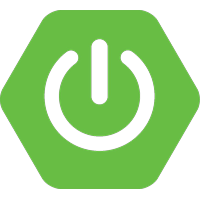
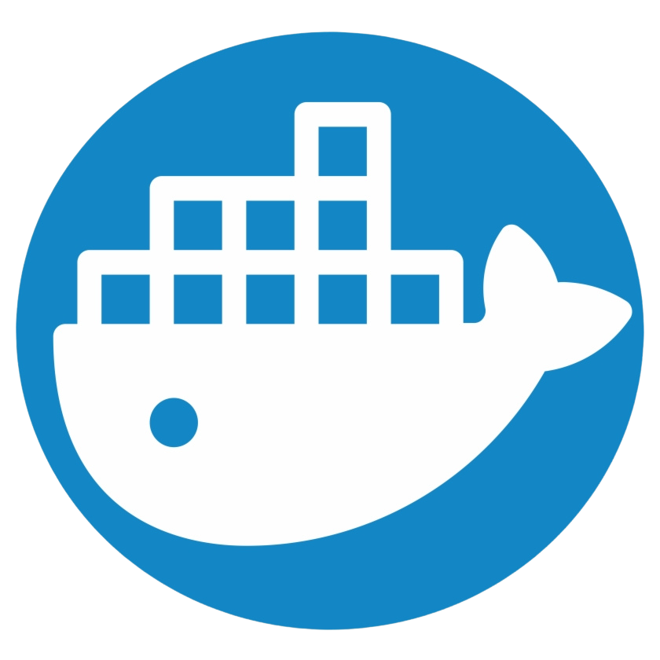

```java
public class AamirHussain implements Developer {
    private final String name        = "Aamir Hussain";
    private final String location    = "Nagpur, India";
    private final String university  = "Ramdeobaba University";
    private final String course      = "B.Tech CSE, Batch 2024-2028";

    private final String[] languages = {
        "Java",
        "Python",
        "C",
        "C++",
        "JavaScript",
        "HTML"
    };

    private final String[] frameworks = {
        "Spring Boot",
        "Spring Web MVC",
        "Spring Data JPA",
        "Spring Security",
        "REST APIs",
        "WebSocket",
        "React",
        "Resilience4j"
    };

    private final String[] databases = {
        "PostgreSQL",
        "MySQL",
        "Oracle",
        "Neon",
        "Hibernate ORM"
    };

    private final String[] cloudAndDevOps = {
        "Docker",
        "Kubernetes",
        "Google Cloud",
        "Railway",
        "Vercel",
        "GitHub Actions"
    };

    private final String[] messagingAndObservability = {
        "Apache Kafka",
        "Redis"
    };

    private final String[] tools = {
        "Git",
        "Maven",
        "Postman",
        "npm"
    };

    @Override
    public void connect() {
        System.out.println("GitHub   -> github.com/AamirrH");
        System.out.println("LinkedIn -> linkedin.com/in/aamir-hussain-359513328");
    }

    public static void main(String[] args) {
        new AamirHussain().connect();
    }
}
```


## 🛠️ Tech Stack

**Languages**
<p>
  &nbsp;&nbsp;&nbsp;
  &nbsp;&nbsp;&nbsp;
  &nbsp;&nbsp;&nbsp;
  &nbsp;&nbsp;&nbsp;
  &nbsp;&nbsp;&nbsp;
  
</p>

**Frameworks**
<p>
  &nbsp;&nbsp;&nbsp;
  &nbsp;&nbsp;&nbsp;
  &nbsp;&nbsp;&nbsp;
  &nbsp;&nbsp;&nbsp;
  &nbsp;&nbsp;&nbsp;
  
</p>

**Databases**
<p>
  &nbsp;&nbsp;&nbsp;
  &nbsp;&nbsp;&nbsp;
  &nbsp;&nbsp;&nbsp;
  &nbsp;&nbsp;&nbsp;
  
</p>

**Cloud & DevOps**
<p>
  &nbsp;&nbsp;&nbsp;
  &nbsp;&nbsp;&nbsp;
  &nbsp;&nbsp;&nbsp;
  &nbsp;&nbsp;&nbsp;
  &nbsp;&nbsp;&nbsp;
  
</p>

**Messaging & Caching**
<p>
  &nbsp;&nbsp;&nbsp;
  
</p>

**Tools**
<p>
  &nbsp;&nbsp;&nbsp;
  &nbsp;&nbsp;&nbsp;
  &nbsp;&nbsp;&nbsp;
  
</p>


